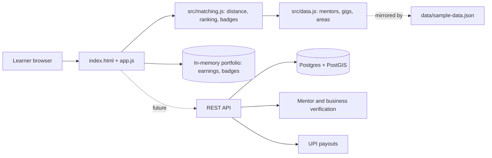

# SkillSwap: Technical Design

## Overview
A static, client-side prototype (HTML, CSS, vanilla JS) of the core loop: **match, do a paid gig, earn, build a portfolio**. No build step or backend.

## Architecture

## Modules
| File | Responsibility |
|---|---|
| `src/matching.js` | Haversine distance, skill filter, nearest-first ranking, verified-mentor filter, earnings, badges. Pure, unit-tested. |
| `src/data.js` | Sample dataset (works in browser and Node). |
| `app.js` | Renders matcher, gig board, mentors, portfolio; handles "Accept gig". |
| `data/sample-data.json` | JSON copy of the dataset (a test keeps it in sync). |

## Data model
- **Mentor**: id, name, skill, area, years, verified
- **Gig**: id, title, business, skill, area, pay (INR), hours
- **Portfolio entry**: completed gig, pay (in memory in the prototype)

## Decisions
- Matching uses haversine distance between neighbourhood centres; production would use PostGIS.
- Only verified mentors are shown.
- Badges: 1 gig = First gig, 3 = Rising, 5 = Job-ready.

## SDG mapping
SDG 4 through mentored practice; SDG 8 through paid work and a verifiable portfolio.

## Roadmap
Auth, verification, UPI payments, WhatsApp notifications, shareable portfolio links.
